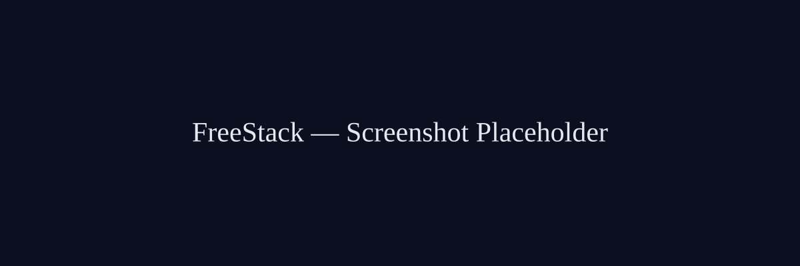

<p align="center">
  <picture>
    
  </picture>
</p>

# FreeStack :: THE $0 DIAL

**Websites, MCP servers, SSH tunnels, APIs, databases, AI, email — at `$0/mo`. Real, runnable setup code. Zero lock-in.**

<p align="center">
  <a href="LICENSE"></a>
  
  
  
  
</p>

```
[ FREQ $0.00 ]  the free dial. nothing on this band costs money.
```

<pre>
IDENT ......... STACK-00
CLASS ......... FREE-TIER INFRA CATALOG
STATUS ........ ONLINE / RUNNABLE
PRICE ......... $0.00 / MONTH
LOCK-IN ....... ZERO (ESCAPE HATCHES EVERYWHERE)
LINK .......... /FreeStack
</pre>

---

## // 01 :: SIGNAL

A self-contained "run it free" kit library: a researched `FRAMEWORK.md` plus working scripts, configs, templates, and apps that make the free tier real. No fluff, no locked-in services — escape hatches everywhere.

---

## // 02 :: THE DIAL (WHAT'S INSIDE)

```
00-MasterList           A-Z index of ~150 free services
01-Websites             static + dynamic hosting deploy kits
02-MCP-Servers          runnable MCP servers (TS + Python) + deploy
03-SSH-Tunnels          tunnel one-liners, wrappers, self-hosted sish
04-APIs                 free-API catalog + caching Worker router
05-LLM-AI               multi-provider failover LLM router + Ollama
06-Databases            keep-alive, backup automation, Postgres
07-Cloud-VMs-Compute    Oracle/GCP always-free VM provisioning + hardening
08-Object-Storage       rclone + R2/B2 private-bucket serving
09-Email                Resend/SMTP send scripts + domain mail loop
10-Git-CICD             GitHub Actions workflows (deploy/cron/backup)
11-Monitoring-Analytics Better Stack + Healthchecks + Uptime Kuma
12-Domains-DNS          is-a.dev generator + Cloudflare DNS + DuckDNS
13-Functions-Serverless complete Cloudflare Worker API project
14-Search-Data          RAG pipeline + Meilisearch compose
15-Meta-Framework       whole-stack bootstrap + free-tier audit
```

---

## // 03 :: CAPABILITIES

- **~150 free services cataloged** (`00-MasterList`) — the free tier that actually works.
- **Multi-provider LLM failover router** (`05-LLM-AI`) — OpenRouter → Groq → Cerebras → Gemini → Mistral on 429/timeout, zero cost.
- **Free-API router** (`04-APIs`) — weather, crypto, FX, geo, news behind a caching Cloudflare Worker.
- **Always-free compute** (`07`) — Oracle Arm VM (2 vCPU / 12 GB / 200 GB) + GCP e2-micro provisioning and hardening.
- **Self-hosted everything** — Postgres, Meilisearch, Uptime Kuma, sish tunnels via `docker compose`.
- **Automated backups & keep-alives** (`06`, `08`) — nightly `pg_dump` → R2, so free tiers never snooze.
- **Zero lock-in** — Postgres (`pg_dump`), S3-compatible (`rclone`), OpenAI-compatible (router), and git. Every escape hatch included.
- **No card required** — every account is free; only a real `.com` TLD (~$10/yr) is optional, and `is-a.dev` removes even that.

---

## // 04 :: SETUP // TUNE TO $0

### Clone and jump into a kit

```bash
$ git clone <your-url> FreeStack
$ cd FreeStack/05-LLM-AI
$ cp ../.env.example ../.env    # fill in keys
$ python llm_router.py "hello from $0/month"
```

Each folder carries its own `README.md` with exact commands. Scripts are idempotent and safe to re-run. Where a service requires a real account, scripts stop and print the 2-minute signup step instead of failing silently.

---

## // 05 :: THE PROFESSIONAL ROLLOUT

Phase 0 — accounts (5 min each, all free, most no card):
`Cloudflare` → `GitHub` → `Neon` (or Supabase) → `OpenRouter` → `Resend`

Phase 1 — identity & edge: `is-a.dev` subdomain → Cloudflare DNS

Phase 2 — compute (`07`): Oracle Always Free VM (2 Arm / 12GB / 200GB) + Google e2-micro

Phase 3 — data (`06` + `08`): Neon database → keep-alive → nightly backups to R2

Phase 4 — apps (`01` + `13` + `02`): Cloudflare Pages site → Worker API → MCP servers

Phase 5 — glue (`10` + `11`): GitHub Actions (deploy/cron/backup) → Better Stack + Healthchecks watching everything

Phase 6 — the meta (`15`): `bootstrap.sh` provisions the rest; `audit.sh` re-verifies free tiers quarterly.

---

## // 06 :: RULES OF THE ROAD

- **Free tiers mutate.** `15-Meta-Framework/audit.sh` re-checks every quarter.
- **Nothing locks you in** — Postgres (`pg_dump`), S3-compatible (`rclone`), OpenAI-compatible (router), git. Escape hatches everywhere.
- **The ONLY recurring cost** in this entire stack is a real `.com` TLD if you ever want one (~$10/yr). `is-a.dev` removes even that.

<details>
  <summary><code>$ cat manifest/repo-layout</code></summary>

- `.sh` scripts target Linux (the free VMs / GitHub Actions).
- `.ps1` scripts target Windows (your machine).
- `.github/` at the root is meant to be copied into a real GitHub repo.
- Every script reads secrets from `../.env` (never hardcoded). See `.env.example`.

</details>

---

## // 07 :: LEGAL

**License:** [MIT](LICENSE)

---

```
 ┌─────────────────────────────────────────────┐
 │  THE FREE DIAL // $0.00, FOREVER           │
 │  150+ SERVICES // NO CARD, NO LOCK-IN      │
 └─────────────────────────────────────────────┘
END OF TRANSMISSION
```